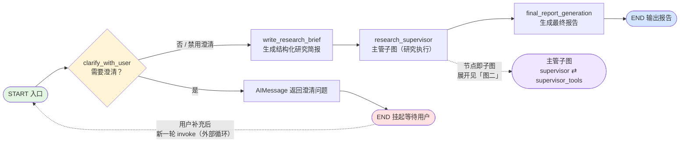
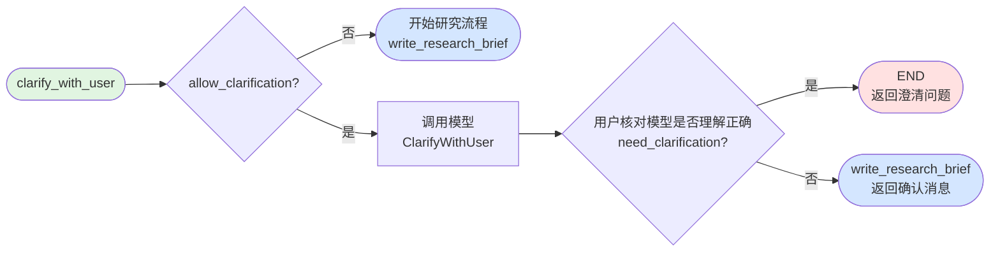
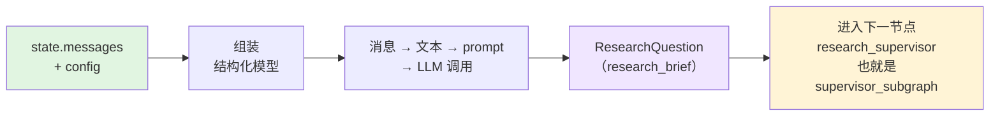
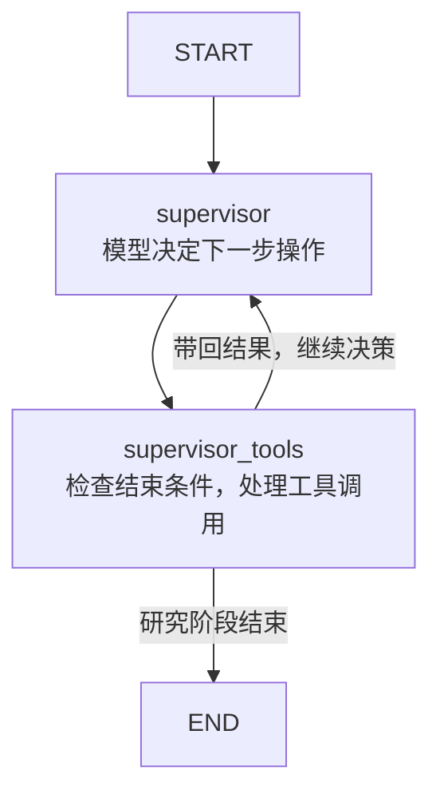
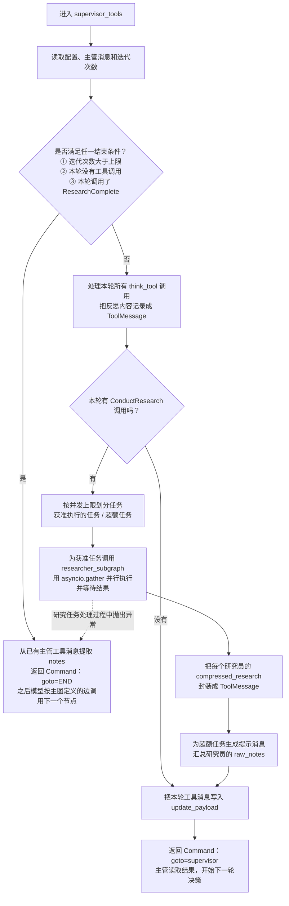

## 整体编排流程

这个是整个 DeepResearch 的执行流程

## clarify_with_user澄清节点 函数流程图

Agent 觉得需求有歧义、范围不清，通过反问的方式问用户理解的对不对

## write_research_brief 节点

将和用户的聊天归纳/聚焦成研究问题，简单来说就好似「用 LLM 把聊天记录翻译成研究简报」+「用代码重置主管上下文」

## research_supervisor 节点

### 子图流程

### supervisor_tools

`supervisor_tools` 节点判是否结束研究，最终子图END之后，有LangGraph 按主图定义的边调度 `final_report_generation`

